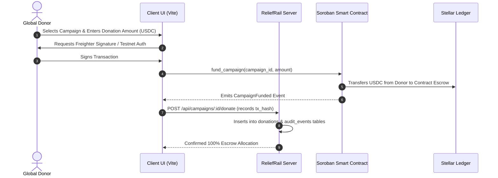
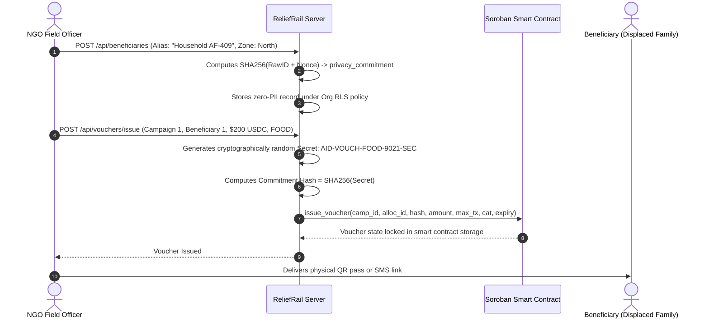
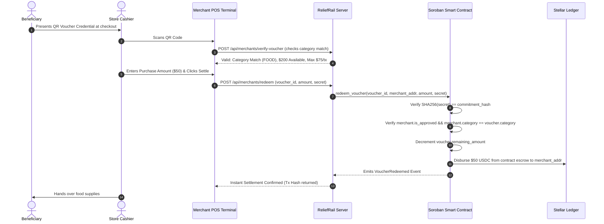

# 🏗️ RELIEFRAIL Architecture Specification

## 1. System Overview

RELIEFRAIL is engineered as a hybrid on-chain / off-chain programmable humanitarian aid delivery system. The core architectural philosophy is:

> **"Financial invariants and monetary custody belong on-chain in Soroban smart contracts; sensitive identity, logistical indexing, and low-latency POS coordination belong off-chain in private, privacy-preserving infrastructure."**

---

## 2. On-Chain vs. Off-Chain Separation

| Component | Layer | Storage / Execution | Rationale |
| :--- | :--- | :--- | :--- |
| **Aid Escrow Vault** | On-Chain | Soroban Smart Contract | Guarantees funds cannot be embezzled or redirected; programmatic custody. |
| **Voucher State Machine** | On-Chain | Soroban Smart Contract | Cryptographically enforces spending caps, expiration dates, and category validity. |
| **Settlement Clearing** | On-Chain | Soroban Smart Contract | Disburses Circle USDC directly to verified merchant wallets with 0% intermediary cut. |
| **Beneficiary Identity** | Off-Chain | PostgreSQL with RLS | **Zero PII on-chain**. Only hashed cryptographic commitments are recorded. |
| **Audit Log Indexer** | Off-Chain | PostgreSQL / Horizon Worker | Indexes on-chain contract events for real-time sub-second queries and mathematical reconciliation. |
| **Offline Merchant Sync** | Edge / Client | Local Storage / PWA | Allows point-of-sale scanning in disconnected disaster areas, syncing when connectivity resumes. |

---

## 3. Core Interaction Workflows

### 3.1 Donation & Escrow Funding Workflow

---

### 3.2 Beneficiary Enrollment & Programmable Voucher Issuance

---

### 3.3 Merchant Redemption & Instant Settlement

---

## 4. Disaster Resilience & Low-Bandwidth Operation

In active catastrophe regions (earthquakes, cyclones, armed conflicts), cell networks are frequently degraded or severed:

1. **Self-Contained QR Credentials**: The generated QR barcode encodes the cryptographic commitment, expiration timestamp, category tag, and maximum transaction cap.
2. **Offline POS Verification**: Approved merchants with cached public keys can perform cryptographic format validation locally without active internet.
3. **Store-and-Forward Settlement Queue**: Once the merchant terminal regains satellite, mesh, or cellular data, queued redemption payloads are submitted to the Stellar network in batches. Replay attacks are prevented because each redemption requires an incrementing nonce verified by Soroban.

---

## 5. Security & Isolation Boundaries

- **Local Cargo Isolation**: Local `.cargo/config.toml` targets `x86_64-unknown-linux-gnu` with empty flags, isolating the workspace from conflicting global WASM NEAR flags.
- **PostgreSQL Row-Level Security**: Beneficiary privacy rows are visible strictly to the registering NGO organization via `current_wallet()` session context. Public users and external auditors can only query aggregated metrics and anonymized commitments.
- **Contract Nonce Deduplication**: Each Soroban voucher entry uses unique identifiers; redemptions cannot be double-spent or submitted twice.

